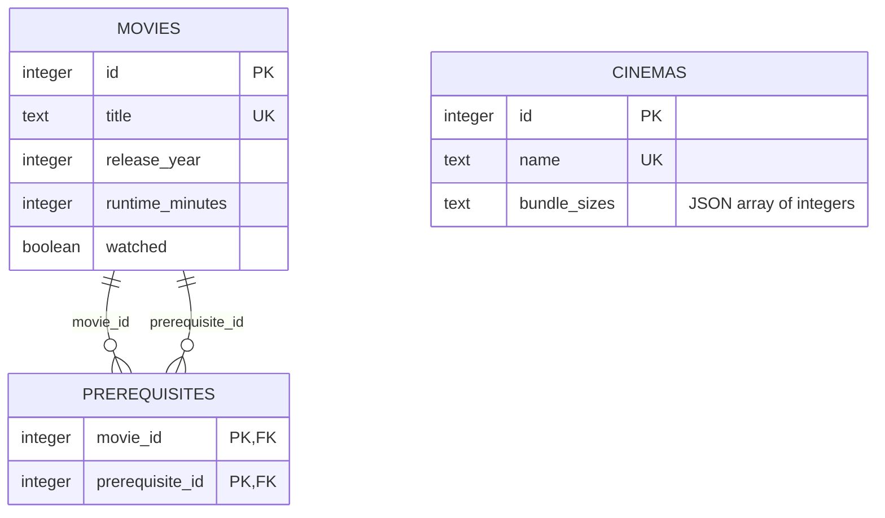

# Doomsday Ready

A local full-stack app for planning an MCU rewatch and finding the smallest set of cinema seat bundles that fits an opening-night group exactly.

## Run locally

Use Node.js 24 or later with npm.

```sh
npm ci
npm run dev
```

Open [Doomsday Ready](http://localhost:3000). To run the production build, use `npm run build` followed by `npm start`. Run `npm test` for API and algorithm checks. With Google Chrome installed, run `npm run test:e2e` for browser checks on the production build. See the [QA checklist](docs/qa.md) for coverage and manual checks.

The app seeds eight movies and four sample cinemas on the first run. SQLite stores edits in `data/doomsday.sqlite`. Set `DATA_FILE` to use a different database or `PORT` to use a different port.

### Docker Compose

```sh
docker compose up --build
```

Open the same local URL. The named `doomsday-data` volume preserves changes across container restarts and rebuilds.

## Use the app

- **Movies** lets you add films with optional prerequisites, edit those links, and mark films watched or unwatched.
- **Rewatch Plan** lists every prerequisite before its dependants, counts completed films, and adds the runtimes of the unwatched ones.
- **Booking** lets you choose or add a cinema and request an exact-seat quote for your group. Quotes show bundle counts and do not place reservations.

## API

All endpoints use the `/api` prefix. JSON writes require `Content-Type: application/json`.

| Method and path | Request or response |
| --- | --- |
| `POST /movies` | Send `title`, `releaseYear`, and `runtimeMinutes`. Optionally send `watched` and `prerequisiteIds`. Returns the saved movie with `id` and HTTP 201. |
| `GET /movies` | Returns the array of movies. |
| `PATCH /movies/:id` | Send any subset of the writable movie fields. Passing `prerequisiteIds: []` clears the links. Returns the updated movie. |
| `GET /movies/:id/rewatch-order` | Returns `{ order, watchedCount, remainingMinutes }`. Each element of `order` is a movie. |
| `POST /cinemas` | Send `name` and `bundleSizes`. Returns the saved cinema with `id` and HTTP 201. |
| `GET /cinemas` | Returns the array of cinemas. |
| `GET /cinemas/:id/booking?groupSize=6` | Returns `{ possible, groupSize, bundleCount, bundles }`. An impossible quote includes only `possible: false` and `groupSize`. |

For example, cinema 1 and group size 6 return:

```json
{
  "possible": true,
  "groupSize": 6,
  "bundleCount": 2,
  "bundles": [{ "size": 3, "quantity": 2 }]
}
```

Errors use `{ code, message }`. Invalid fields return 400, missing records return 404, and uniqueness conflicts return 409 with `DUPLICATE_NAME`. A direct or indirect prerequisite cycle returns 409 with `CIRCULAR_DEPENDENCY`. Rejected movie changes are rolled back.

## Data model



## Algorithms and assumptions

- Rewatch planning uses iterative depth-first search. It adds each prerequisite after visiting its own prerequisites and skips movies already processed. Encountering a movie still on the current path exposes a cycle. The traversal takes linear time in the reachable movies and prerequisite links, after loading the graph from SQLite.
- Booking uses bottom-up dynamic programming. For each seat total, it checks which bundle can be added to a smaller reachable total with the fewest purchases. It records the chosen size to reconstruct the quote. Runtime is proportional to the group size multiplied by the number of available sizes. When several combinations use the same minimum number, the algorithm tries the larger final bundle first for each seat total.
- The assessment puts `1–300` next to “release year and runtime in minutes.” The range applies to runtime. New or explicitly changed release years must be whole numbers from 1888 through the current UTC year. The 1888 lower bound uses the year of the earliest surviving film documented by the [Science Museum Group](https://collection.sciencemuseumgroup.org.uk/objects/co18634/single-lens-cine-camera-by-louis-le-prince). Since the app stores only a year, a release later in the current year is valid. Existing out-of-range years are preserved and can be corrected through `PATCH`. The Doomsday sample runtime is a placeholder, and the graph uses the assessment’s example links.
- Titles and cinema names are trimmed and compared with SQLite’s ASCII case-insensitive collation. Duplicate prerequisite IDs collapse into a single link. Cinema bundle sizes must be distinct. All users of the same local database share the watched flags.

## Code map

| Path | Responsibility |
| --- | --- |
| `src/main.jsx` | Navigation, shared lists, and movie saves that stay locked across view changes. |
| `src/views/` | One component file per assessment view. |
| `src/api.js` | JSON requests and messages for failed connections or responses. |
| `shared/movie-rules.js` | Movie year and runtime rules used by both the client and server. |
| `server/api.js`, `server/db.js` | API validation, SQLite schema and seed data, and transactions for movie writes. |
| `server/algorithms.js` | Prerequisite ordering and exact-seat bundle quotes. |
| `test/`, `e2e/` | Direct algorithm and HTTP tests, plus Chrome workflow tests. |

## AI assistance

OpenAI Codex generated the initial application and assisted with the UI, algorithms, tests, Docker setup, and documentation. A separate Codex agent reviewed the code and designed edge cases. Codex ran the checks and fixed issues found during verification. The two assessment algorithms are implemented directly in JavaScript without a graph or optimization library.
